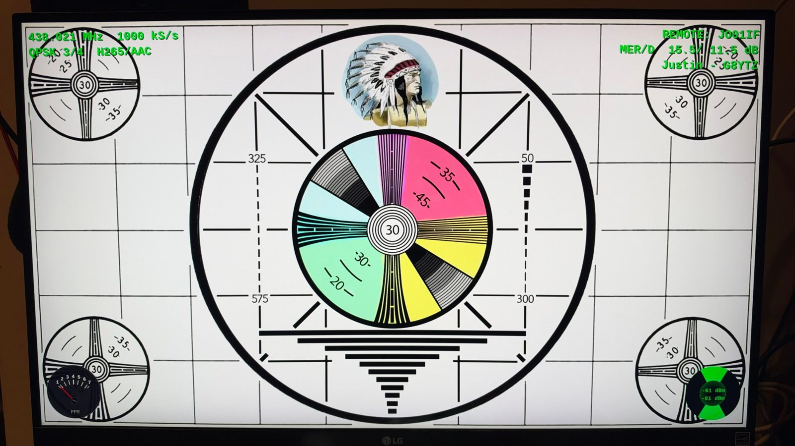
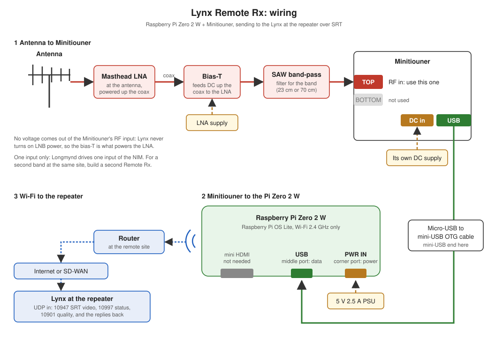
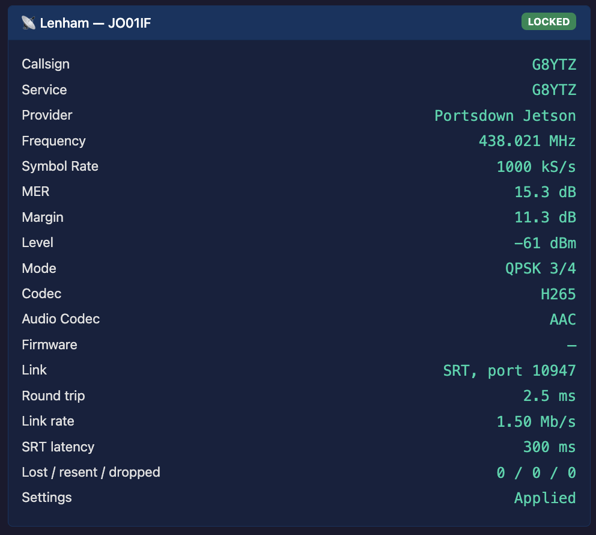

# Lynx Remote Rx

A Remote Rx is a small receiver at another site, built from a Raspberry Pi Zero 2 W and a standard Minitiouner, unmodified. It tunes one DATV signal and sends the picture back to a Lynx receiver at the repeater over SRT, along with its lock, MER and callsign. At the repeater it appears as one more receiver, with its own panel and a Watch button.

It needs no ports opening at the remote site: The Remote Rx always calls out to the repeater. Once it is built, everything else (frequency, symbol rate, name and locator) is set from the Lynx at the repeater, and the Remote Rx keeps those settings through a power cut.



*A test card from a Portsdown on 438 MHz, received by the Remote Rx (JO01IF) and shown on the Lynx at home over SRT: The overlay says **REMOTE** and the Remote Rx's locator.*



## What you need

| Part | Notes |
|---|---|
| Raspberry Pi Zero 2 W | The original Zero is too slow. |
| microSD card, 8 GB or larger | |
| 5 V 2.5 A micro-USB power supply | The official Zero supply is ideal. |
| Minitiouner | A standard Minitiouner, with its own DC supply. Do not try to power it from the Pi. A Picotuner (the non-Ethernet one) is not supported yet: It presents differently over USB and has not been tested here. |
| Micro-USB to mini-USB OTG cable | Micro-USB plug for the Zero, mini-USB plug for the Minitiouner, sold as "OTG", [for example this one](https://www.amazon.co.uk/dp/B0D9HMQQY9). Or use the Minitiouner's usual USB cable with an OTG adapter (micro-USB plug to USB-A socket). |
| Masthead LNA for the band | Mounted at the antenna. |
| Bias-T and a supply for the LNA | Feeds DC up the coax to the LNA. |
| SAW band-pass filter for the band | Protects the Minitiouner's front end from strong signals outside the band. |

## Wiring

1. **Antenna to Minitiouner:** Antenna, masthead LNA, coax, bias-T, SAW filter, then the Minitiouner's **TOP** RF input. The Minitiouner never puts voltage on its RF input here (Lynx doesn't turn on LNB power), so the bias-T is what powers the LNA. Put the bias-T between the coax and the SAW filter: Most SAW filters block DC.
2. **Minitiouner to the Pi:** The micro-USB to mini-USB OTG cable, from the Minitiouner's mini-USB socket to the Zero's **middle** micro-USB port, marked USB. That's the data port.
3. **Power:** The 5 V supply goes into the Zero's **corner** micro-USB port, marked PWR IN. The Minitiouner gets its own DC supply as usual.
4. **Network:** Wi-Fi to the router at the remote site. The Zero 2 W only does 2.4 GHz Wi-Fi.

**One input only.** Longmynd drives one input of the Minitiouner's NIM, and the Remote Rx uses the TOP one. The BOTTOM input isn't used. To receive two bands at the same site, build two Remote Rx.

**Which filter goes where:** The LNA sets the noise figure, so it goes first, at the antenna. The SAW filter after it stops anything strong outside the band (broadcast TV, mobile phone masts, pagers) from overloading the Minitiouner. If a very strong local transmitter overloads the LNA itself, you need a filter in front of it as well.

## Step 1: Prepare the SD card

Use Raspberry Pi Imager on any computer.

1. **Device:** Raspberry Pi Zero 2 W.
2. **Operating system:** Raspberry Pi OS (other), then **Raspberry Pi OS Lite (64-bit)**. No desktop is needed.
3. **Storage:** Your SD card.
4. When asked, choose **Edit settings** and fill in:
   - **Hostname:** For example `lynx-remote-rx`.
   - **Username:** `pi`. It must be `pi`: The installer and the service expect `/home/pi`.
   - **Password:** Your choice.
   - **Wireless LAN:** The Wi-Fi name and password at the site where it will live, and the country (GB).
   - **Services:** Tick **Enable SSH**, with password authentication.
5. Write the card, put it in the Zero, connect everything and power up.

The first boot takes a few minutes. If you are building it at home to take to another site later, enter your home Wi-Fi now and add the remote site's Wi-Fi afterwards (see "Moving it to another site" below).

## Step 2: Log in

From a computer on the same network:

```
ssh pi@lynx-remote-rx.local
```

If the name isn't found, look up the Zero's address in your router's device list and use `ssh pi@<address>` instead.

## Step 3: Install

Copy and paste the whole block in one go:

```
sudo apt update &&
sudo apt full-upgrade -y &&
sudo apt install -y git &&
git clone --depth 1 --filter=blob:none --sparse -b beta https://github.com/G8YTZ/lynx-datv-receiver.git ~/lynx-datv-receiver &&
git -C ~/lynx-datv-receiver sparse-checkout set slave &&
~/lynx-datv-receiver/slave/install.sh
```

Each step runs only if the one before it worked, so a failure stops there
rather than carrying on against a half-built system. Expect it to take a
while on a Zero 2 W: the upgrade and the Longmynd build are both slow.
Watch the end of it, because the installer prints this Remote Rx's key.

This fetches only the Remote Rx part of Lynx, not the whole receiver. The installer then:

- installs `srt-tools`;
- downloads and builds **Longmynd**, the BATC's Minitiouner driver, in `~/longmynd`;
- installs the udev rule that lets it use the Minitiouner without root;
- creates the settings file `/etc/lynx-slave.conf`;
- makes this Remote Rx's **key** and prints it: **Write it down**, you need it at the repeater;
- starts the service, which runs at every boot from then on.

Finish with `sudo reboot`, so the udev rule applies to the Minitiouner.

## Step 4: Tell it where the repeater is

```
sudo nano /etc/lynx-slave.conf
```

Set `LYNX_HOST` to the address of the Lynx at the repeater: Its address on the SD-WAN, or the repeater's public address or DNS name if it comes over the internet. Check `TRANSPORT="srt"`. Then press Ctrl-O, Enter, Ctrl-X to save, and restart:

```
sudo systemctl restart lynx-slave
```

The frequency, symbol rate, name and locator in this file are only used until the repeater sends its own, so you can leave them.

## Step 5: Set it up at the repeater

On the Lynx at the repeater, open the web page, then **Config**, **Remote Rx**:

1. Tick **Enabled**.
2. Under **Settings sent to the Remote Rx**, enter the frequency (MHz), symbol rate (kS/s), name and locator.
3. Paste the **key** from step 3.
4. Click **Save**.

Within a few seconds the Remote Rx panel appears with Settings: **Applied**, and the Remote Rx retunes.

 In the **Remote Receivers** box on the main page, click **Watch** to put it on screen. The overlay shows **REMOTE** and the locator.

### Ports at the repeater

If the Remote Rx comes in over the internet rather than an SD-WAN, the repeater's router must forward these **UDP** ports to the Lynx receiver:

| Port | What |
|---|---|
| 10947 | SRT video |
| 10997 | Status (lock, callsign) and the settings sent back |
| 10901 | Quality (MER, level) |

Nothing needs opening at the remote site.

## Checking it

On the Remote Rx:

```
journalctl -u lynx-slave -n 30 --no-pager
```

What good looks like:

- `config : remote, settings version …`: It is using the settings from the repeater.
- `SRT target connected`: The video link is up.
- `[tuner] locked - G8YTZ 438.021 MHz MER 24.2 dB`: It has a signal and can read the callsign.

At the repeater, the Remote Rx panel shows the link's round-trip time, data rate and the SRT lost, resent and dropped counts. Resent packets are normal on the internet; dropped packets mean the SRT latency is too short for the link.

## Updating

Normally there is nothing to do here: On the Lynx at the repeater, the
Remote Rx panel shows the version it is running, and an **Update**
button appears when this receiver is on a newer one. Pressing it sends
a signed command in reply to the Remote Rx's next heartbeat. The Remote
Rx fetches, refuses the update unless the new code compiles and starts,
then restarts. If the new version will not stay running it puts the old
one back by itself.

**The first update must be done by hand.** A Remote Rx built before the
Update button existed has no code to act on the command, so it ignores
it. Once, on the Remote Rx:

```
cd ~/lynx-datv-receiver && git pull && sudo systemctl restart lynx-slave
```

After that the button works. Run `./install.sh` again only when the
wrapper or the systemd unit has changed; the installer is safe to run
again and keeps your settings and your key.

## Moving it to another site

Add the new site's Wi-Fi before you take it there:

```
sudo nmcli dev wifi connect "SITE-WIFI-NAME" password "SITE-WIFI-PASSWORD"
```

The Zero remembers both networks and joins whichever it finds. Change `LYNX_HOST` too if the repeater's address is different from the new site.

## Troubleshooting

| What you see | Likely cause |
|---|---|
| No Remote Rx panel at the repeater | It isn't ticked **Enabled** in Config, or the status port (10997) isn't reaching the Lynx. |
| Panel shows offline | The Zero isn't running or has no network. Check Wi-Fi, and `systemctl status lynx-slave`. |
| Locked, but NO VIDEO | SRT isn't connecting: Check port 10947 at the repeater, and `LYNX_HOST`. |
| Settings: No key on the Remote Rx | The key line is missing from `/etc/lynx-slave.conf`. Run `./install.sh` again. |
| Settings stay "Sending…" | The keys don't match. Copy the `KEY` from `/etc/lynx-slave.conf` into Config again. |
| Never locks | Wrong frequency or symbol rate, aerial on the BOTTOM input, or no power to the LNA. |
| `longmynd` can't open the Minitiouner | Unplug and replug it, or reboot, so the udev rule applies. |

To go back to the frequency and name in `/etc/lynx-slave.conf` instead of the repeater's, delete `/var/lib/lynx-slave/settings.json` and restart the service.
